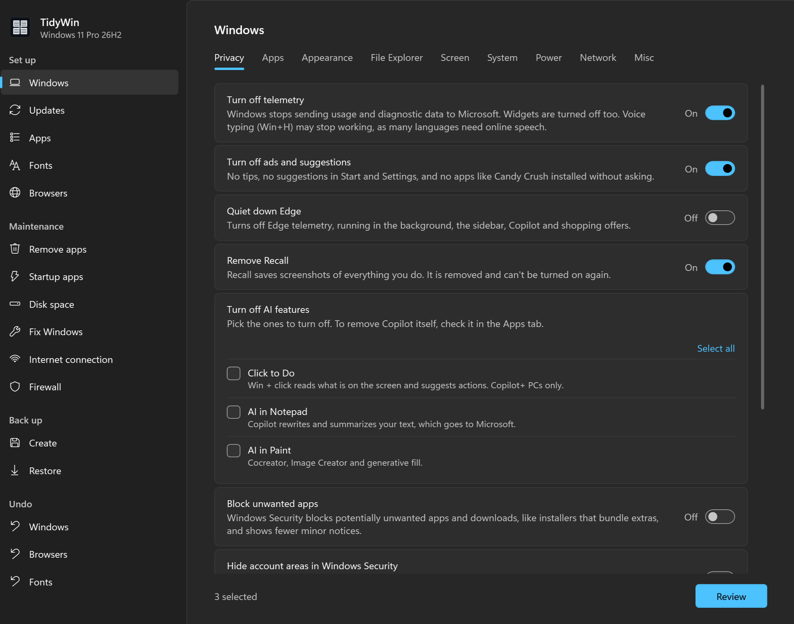

<div align="center">


# TidyWin

**Set up and look after your Windows PC from one window.**

Turn off telemetry and bloat, install your apps and fonts, fix common problems<br>
and back up what matters before formatting. Nothing changes until you pick it.

[](https://github.com/androksi/tidywin/actions/workflows/lint.yml)
[](#good-to-know)
[](LICENSE)

<br>



</div>

<br>

## Quick start

Right-click the Start button, choose **Terminal** (or PowerShell) and run:

```powershell
irm androksi.github.io/tidywin/run | iex
```

It asks for administrator rights and opens the TidyWin window. Pick a page in the sidebar: its options show up right away, nothing selected. Turn on what you want, **Review** and **Apply**; the progress shows in the same window.

> [!CAUTION]
> **Disclaimer.** TidyWin changes system settings, removes apps and turns Windows features off. Parts of it are best used on a **fresh Windows installation**, where there is nothing to lose. On a PC you already use, read what each option does, change only what you understand and go one step at a time. TidyWin is provided as is, without warranty: you use it at your own risk.

## What's inside

<div align="center">

| | Pages | |
|:---|:---|:---|
| **Set up** | Windows · Updates · Apps · Fonts · Browsers | Privacy, appearance, File Explorer, power and network; how Windows Update works; 106 apps and 19 fonts from their official sources; a more private Chrome, Brave and Firefox |
| **Maintenance** | Remove apps · Startup apps · Disk space · Fix Windows · Internet connection · Firewall | Official uninstallers plus leftovers, what starts with Windows, temporary files, DISM and `sfc`, network resets that keep your DNS, the firewall rules your apps added |
| **Back up** | Create · Restore | Drivers, apps, Wi-Fi networks and the BitLocker key in one folder, before and after formatting |
| **Undo** | Windows · Browsers · Fonts | Put back what TidyWin changed, one item at a time |

</div>

<div align="center">

[Windows](docs/windows.md) · [Updates](docs/windows.md#updates) · [Startup apps](docs/windows.md#startup-apps) · [Firewall](docs/windows.md#firewall) · [Apps](docs/apps.md) · [Fonts](docs/fonts.md) · [Browsers](docs/browsers.md) · [Back up](docs/backup.md) · [Drivers](docs/drivers.md) · [Reinstalling Windows](docs/reinstall.md)

</div>

> [!TIP]
> Formatting the PC? Follow [Reinstalling Windows, step by step](docs/reinstall.md): it lists the pages in the right order. Your drivers, apps and Wi-Fi networks go with [Back up and Restore](docs/backup.md).

## Good to know

- **Nothing comes selected.** Only what you turn on is changed, and Review lists it before anything happens.
- **Restore points.** The Windows, Remove apps and Fix Windows pages create one first; the Windows page also saves a log on your Desktop.
- **Untouched.** Windows Defender and Safe Browsing are never changed. Windows Update and the Firewall only change from their own pages.
- **Runs again safely.** Every page can be applied more than once.
- **Leaves nothing behind.** The scripts are downloaded to `%TEMP%\tidywin` and deleted when TidyWin closes.
- **Requirements.** Windows 10 or 11 and administrator rights (asked for automatically). Windows PowerShell 5.1 comes with Windows.

<details>
<summary><b>Run from a local copy</b></summary>
<br>

```powershell
git clone https://github.com/androksi/tidywin
cd tidywin
Set-ExecutionPolicy -Scope Process -ExecutionPolicy Bypass
.\scripts\TidyWin.ps1
```

Run it as administrator. The panel uses the scripts next to it instead of downloading them. Each script also runs on its own, for example `.\scripts\windows\clean-windows.ps1`. The browser and font scripts accept `-Revert`, and the Windows page is undone by `revert-configure-windows.ps1`.

</details>

---

<div align="center">

[Report an issue](https://github.com/androksi/tidywin/issues) · [GPL-3.0](LICENSE)

</div>
